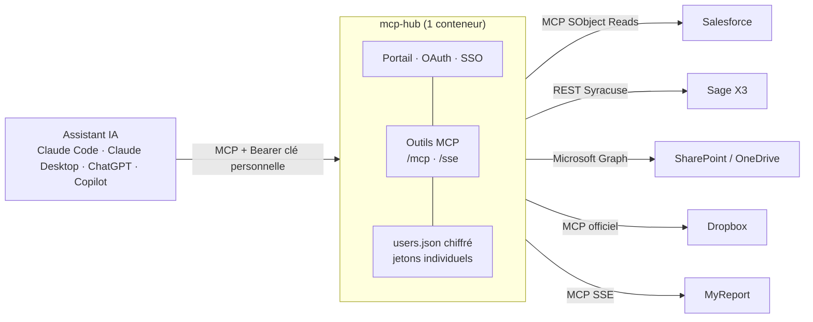

# Clevoa AI Gateway

Passerelle MCP **en lecture seule** entre les assistants IA (Claude Code, Claude Desktop, ChatGPT, Copilot) et les
outils métier d'une entreprise : CRM Salesforce, ERP Sage X3, documents SharePoint / OneDrive et Dropbox, reporting
MyReport. Chaque appel porte le jeton **personnel** du collaborateur : l'assistant ne voit que ce que le collaborateur
a déjà le droit de voir, et le hub n'a aucun compte technique.

Édité par Clevoa SASU. Premier client : Groupe Charlois (direction financière) ; qualification en cours sur sa
préproduction, aucune instance en production. Chaque instance porte son
propre nom de serveur MCP et son libellé (`MCP_SERVER_NAME`, `INSTANCE_LABEL`).

## Ce que fait la passerelle

* **Un seul conteneur Node 24**, sans framework ni serveur de base de données (SQLite intégré à Node pour l'historique
  et les compteurs) : `@modelcontextprotocol/sdk`, `express`, `zod`,
  environ 1 060 lignes. Chaque connecteur est un module d'environ 50 à 190 lignes.
* **Droits de chaque collaborateur** : jetons OAuth ou identifiants individuels, chiffrés (AES-256-GCM) dans un seul
  fichier, transmis tels quels aux outils. Le cache de structure (objets, champs) est lui aussi par utilisateur.
* **Lecture seule par construction** : serveurs MCP et facettes d'API de lecture uniquement, listes blanches d'outils,
  outils annotés `readOnlyHint`. Aucune donnée métier n'est stockée ni mise en cache.
* **Portail web** aux couleurs Clevoa, pensé comme un outil : une ligne par application classée par domaine (Commerce,
  Finance, Documents…) avec l'état de votre connexion et celui du service, assistant à brancher sans défilement,
  questions qui fonctionnent par domaine, thème clair et sombre, accessible (WCAG 2.1 AA vérifié). SSO Microsoft Entra
  ID optionnel.
* **Supervision** : état de chaque système mesuré par le hub (appels de la dernière heure et vérification de
  joignabilité sans identifiant, en semaine aux heures ouvrées), exposé à la supervision : PRTG (`/metrics/prtg`) ou
  format Prometheus pour Zabbix, Centreon… (`/metrics`), jeton dédié.
* **Traçabilité** : chaque résultat se termine par `Source : <système>` que l'assistant est instruit de citer.
* **Exploitation simple** : deux stacks Docker Compose (pré-production, production), sauvegarde quotidienne chiffrée,
  restauration scriptée, reverse proxy nginx fourni, télémétrie de licence réduite à des compteurs.

## Architecture



Détail des modules et des flux : [architecture](docs/developer/architecture.md).

## Connecteurs

| Système | Protocole | Authentification du collaborateur | Outils MCP | État |
|---|---|---|---|---|
| Salesforce | serveur MCP hébergé « SObject Reads » | OAuth2 + PKCE, refresh géré | `salesforce_tools`, `salesforce_call` | vérifié sur sandbox |
| Sage X3 24R1 | API REST Syracuse (`$query`, `$details`, `$prototypes`) | identifiant et mot de passe Syracuse, ou OAuth2 | `sagex3_representations`, `sagex3_describe`, `sagex3_query`, `sagex3_get` | vérifié en préproduction |
| SharePoint / OneDrive | Microsoft Graph (GET) | OAuth2 délégué Entra ID | `sharepoint_sites`, `sharepoint_list`, `sharepoint_search`, `sharepoint_read` | bouchon seulement |
| Dropbox | serveur MCP officiel | OAuth2 | `dropbox_tools`, `dropbox_call` | bouchon seulement |
| MyReport | serveur MCP SSE de MyReport Server | jeton personnel | `myreport_tools`, `myreport_call` | bouchon seulement, serveur éditeur non livré |

« Bouchon seulement » : exercé contre le simulateur d'entreprise et les tests automatisés, jamais sur un vrai compte.
Détail et tests restants : [état des fonctionnalités](docs/validation/etat-des-fonctionnalites.md).

## Démarrage rapide

Avec Docker Desktop et le bouchon d'entreprise (aucun compte réel, deux collaborateurs fictifs aux droits différents) :

```bash
cp .env.example .env                                   # renseigner ENCRYPTION_KEY : openssl rand -hex 32
docker compose -f docker-compose.dev.yml up -d --build  # hub + bouchon
open http://localhost:8080                              # exactement l'adresse de PUBLIC_URL
```

Sur le portail : « Se connecter » à chaque outil (mires du bouchon sur `http://localhost:4000`, comptes Marie et Paul),
vérifier les voyants du diagnostic, copier le bloc de configuration dans l'assistant. Sans Docker :

```bash
cd hub && npm install && npm test                      # 112 tests, aucun réseau
```

Suite détaillée : [installation](docs/admin/installation.md).

## Documentation

| Public | Documents |
|---|---|
| Collaborateur | [Guide utilisateur](docs/user/guide-utilisateur.md) : portail, assistants, lecture des réponses, problèmes courants |
| Administrateur | [Installation](docs/admin/installation.md) · [Configuration des connecteurs](docs/admin/configuration.md) · [SSO Entra ID](docs/admin/sso-entra.md) · [Exploitation, sauvegarde, restauration](docs/admin/exploitation.md) · [Sécurité](docs/admin/securite.md) |
| Développeur | [Architecture](docs/developer/architecture.md) · [Écrire un connecteur](docs/developer/connecteurs.md) · [Tests et analyses](docs/developer/tests.md) · [Contribuer](docs/CONTRIBUTING.md) |
| Validation | [État des fonctionnalités et limites](docs/validation/etat-des-fonctionnalites.md) · [Journal des tests réels](docs/validation/journal-tests-reels.md) · [Campagne de charge v1.2.1](docs/validation/charge-v1.2.1.md) |
| Produit | [Roadmap produit](docs/roadmap-produit.md) : qualification, maintenance, intégrations sur besoin client |
| Historique | [Audits d'octobre 2026](docs/history/audit-2026-10.md) · [Décisions](docs/history/decisions.md) · [Feuille de route d'octobre 2026 (archive)](docs/history/roadmap-2026-10.md) |

Composants annexes : [bouchon d'entreprise](clevoa-mcp-stub/README.md), [backend de télémétrie Clevoa](clevoa-backend/README.md),
[console de suivi Clevoa](clevoa-console/README.md), [outils de charge](loadtest/README.md). Index complet : [docs/README.md](docs/README.md).

## Sécurité et limites connues

* Aucun compte de service : sans jeton personnel, aucun outil ne répond. Le fichier des jetons est chiffré avec une clé
  maîtresse à conserver dans un coffre ; la perdre impose à chaque collaborateur de se reconnecter.
* La clé MCP personnelle se transmet uniquement en en-tête `Authorization: Bearer`, jamais dans l'URL. Les connecteurs de
  claude.ai web et mobile ne sont donc pas pris en charge (choix assumé : le hub reste sur le réseau interne).
* Limitation de débit par adresse IP, plafonds d'appels sortants par connecteur (`MYREPORT_MAX_PER_MIN`,
  `SF_MAX_PER_MIN`), en-têtes de sécurité HTTP, conteneur sans privilèges en lecture seule.
* Télémétrie vers Clevoa toutes les 6 heures, réduite à un identifiant aléatoire d'installation, la version, les
  connecteurs configurés et des compteurs (appels, sièges, erreurs par type et latences par connecteur) ; aucun e-mail,
  jeton, requête, message d'erreur ni résultat ne quitte le hub ([sécurité § 4](docs/admin/securite.md#4-télémétrie-clevoa)).
* Limites actuelles : seul Claude Desktop est vérifié en réel, Claude Code, ChatGPT et Copilot sont testés au niveau du
  protocole MCP seulement ; SharePoint, Dropbox et MyReport non vérifiés sur un vrai compte ; cloisonnement observé sur les
  systèmes réels avec un compte administrateur seulement ; capacité démontrée sur bouchons (50 collaborateurs), pas
  encore sur les systèmes réels. Détail : [sécurité](docs/admin/securite.md), [état des fonctionnalités](docs/validation/etat-des-fonctionnalites.md).

## Licence et releases

Logiciel propriétaire de Clevoa SASU : [LICENSE.md](LICENSE.md). Les dépendances open source conservent leurs licences
(MIT, ISC, BSD). Versions : [CHANGELOG.md](CHANGELOG.md) et
[releases GitHub](https://github.com/sirkazey/Clevoa-IA-gateway/releases) ; version courante **1.5.0-rc.1** (candidate, non qualifiée pour la production)
(`hub/version.js`), affichée sur le portail et dans les journaux de démarrage.
