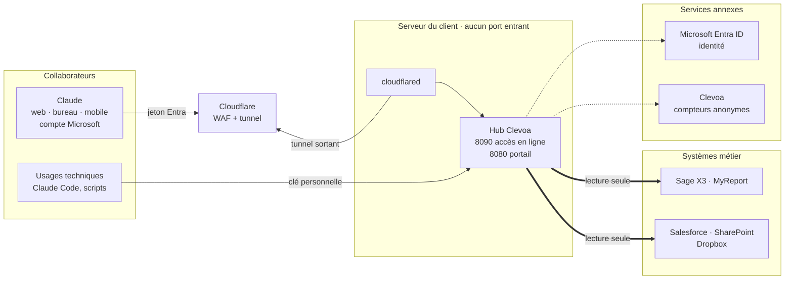

# Architecture

Public : développeur qui reprend le code. Objet : les modules du hub, leurs états et leurs flux.

## 1. Vue d'ensemble

Un conteneur Node 24, six dépendances directes ([dépendances](dependances.md)), un fichier d'état chiffré
(`users.json`), une base d'exploitation SQLite intégrée à Node (`hub.db`). Les connecteurs sont des modules, pas des
services.

Les deux entrées mènent au même hub, aux mêmes outils et aux mêmes droits : ceux du collaborateur, en lecture seule. Le tunnel
est ouvert depuis le serveur (`cloudflared`, connexion sortante) : aucun port n'est ouvert vers l'extérieur. Avec l'accès en ligne, toutes les applications
Claude (web, bureau, mobile, sur le réseau interne ou non) passent par le connecteur et le compte Microsoft (port 8090).
La clé personnelle (port 8080, réseau interne) ne sert plus qu'aux usages techniques, ou à tout le monde si l'accès en
ligne n'est pas activé. Non représentée : la sauvegarde
quotidienne, conteneur `mcp-backup` ([exploitation § 4](../admin/exploitation.md#4-sauvegarde)).

| Module (`hub/`) | Rôle |
|---|---|
| `server.js` | identité par clé, outils MCP, portail, diagnostic, API |
| `online.js` | port en ligne : OAuth relayé vers Entra, jetons Entra vérifiés |
| `oauth.js` | OAuth2 code + PKCE + refresh, pour tous les connecteurs |
| `sso.js` | SSO Entra ID (modes `mock` et `entra`) |
| `store.js`, `crypto.js` | `users.json` chiffré (AES-256-GCM, `ENCRYPTION_KEY`), pseudonymes HMAC |
| `cache.js` | structure des tables, par utilisateur, expirée à 03:00 |
| `mcpclient.js` | client MCP des connecteurs proxy |
| `db.js`, `admin.js` | `hub.db` (disponibilité, usage, audit) et sa lecture par l'administrateur |
| `health.js` | état des systèmes : appels de la dernière heure, HEAD sans identifiant (lun-ven 7-19 h) |
| `telemetry.js` | compteurs envoyés à Clevoa toutes les 6 h |
| `diagnostic.js` | rapport de support sans secret ni donnée métier |
| `resolve.js` | résolution IPv4 d'abord (musl, Docker) |
| `version.js` | `VERSION` et `APP_ENV` |
| `connectors/`, `public/`, `test/` | connecteurs, portail, tests `node:test` |

En pré-production, `mcp-stub` ([`clevoa-mcp-stub/`](../../clevoa-mcp-stub/README.md)) imite les cinq systèmes,
Entra ID et le backend Clevoa.

## 2. Identité et état

* **Clé MCP personnelle** : chaîne aléatoire. Cookie `mcp_key` pour le portail, en-tête `Authorization: Bearer` pour
  les clients MCP. Avec le SSO, une clé ne sert qu'une fois liée à une identité Entra (`oid` + locataire).
* **`store.js`** : `users.json` = `{ users: { <clé>: { createdAt, email, sso?, salesforce?, … } } }`, chiffré sur
  disque (`enc1:`), déchiffré en mémoire. Seules les entrées porteuses d'une identité ou d'un jeton sont écrites. API :
  `get`, `create`, `setTokens`, `clearTokens`, `findSso`, `setSso`, `rotate`, `remove`, `purge`, `seats`.
* **`oauth.js`** : routes `/auth/<système>` et `/auth/<système>/callback`, PKCE S256, `state` lié au cookie, un refresh
  partagé par utilisateur et par système. `withToken(connecteur, clé, fn)` rejoue l'appel après un refresh sur 401 ; un
  refresh token révoqué efface l'entrée. SSO et SharePoint passent par openid-client (id_token vérifié, signature
  comprise).
* **`sso.js`** : `bindIdentity` (clé fraîche à la première liaison), `assertSame` (jetons SharePoint du même compte),
  enchaînement silencieux vers SharePoint (`prompt=none`), déconnexion Microsoft.
* **`online.js`** (expérimental ; `CLOUDFLARE_TUNNEL=1` dans la stack) : second port, sans portail ni clé statique. Le
  relais OAuth du SDK (`ProxyOAuthServerProvider`) transmet `/authorize` et `/token` à Entra ID ; le hub ne délivre
  aucun jeton. Chaque jeton Entra est vérifié (signature, émetteur, locataire, audience, application, scope `mcp`) puis
  rattaché à la clé du collaborateur (`store.findSso`). Le portail refuse toute requête relayée par Cloudflare.
* **`db.js`** : `/data/hub.db` (`node:sqlite`, WAL). Jamais une connexion : `availability` (créneaux de 10 min, 90
  jours), `usage` (par mois, 24 mois), `audit` (si `AUDIT=on`, `AUDIT_DAYS`). Une migration s'ajoute en fin de
  `MIGRATIONS`, jamais modifiée une fois publiée. Toute erreur désactive la base sans toucher aux outils. Instantané
  `hub-instantane.db` toutes les 6 heures, copié par `mcp-backup`.
* En mémoire seulement : flux OAuth en cours, compteurs de débit, sessions SSE, compteurs de télémétrie.

## 3. Serveur MCP et transports

`buildServer(clé)` crée un `McpServer` par connexion, nommé `MCP_SERVER_NAME` (défaut `clevoa-gateway`). Pour chaque
appel : plafond du connecteur (`maxPerMinute`), jeton via `withToken`, résultat terminé par
`Source : <système> · <dossier | sandbox | production>`. Une erreur d'outil devient `isError`, sans arrêter le
processus.

* **Streamable HTTP** (`POST /mcp`) : sans état, un serveur par requête.
* **SSE** (`GET /sse`, `POST /messages?sessionId=`) : session liée à la clé qui l'a ouverte ; à retirer quand tous les
  assistants cibles seront en Streamable HTTP.
* Révisions du protocole 2024-10-07 à 2025-11-25 (celles du SDK), négociées à l'initialisation.
* `INSTRUCTIONS` pour le modèle : citer la ligne Source, interroger Sage X3 et Salesforce quand le système n'est pas
  nommé.

En production (`APP_ENV=production`), un connecteur simulé (`mock`) n'est pas exposé. `CONNECTORS_ENABLED` restreint
les connecteurs proposés (vide = tous).

## 4. Portail

`hub/public/index.html`, une page sans ressource externe (CSP stricte), servie par `express.static`.

| Route | Rôle |
|---|---|
| `GET /api/me` | version, environnement, instance, SSO, e-mail, `name` (prénom Entra `given_name`, sinon nom complet), clé, `assistantAt` (dernier jour d'appel MCP), `mcpUrl`, `online` (adresse `/mcp` publique si l'accès en ligne est actif, sinon `null`), systèmes avec état et domaine |
| `GET /api/status` | état de chaque système, sans volume ni identité |
| `GET /metrics`, `GET /metrics/prtg` | supervision, jeton `METRICS_TOKEN` |
| `GET /api/test/:system` | diagnostic d'un système |
| `POST /api/:system/apikey`, `/api/disconnect/:system`, `/api/key/rotate`, `/api/logout` | état du collaborateur (même origine exigée) |

Le portail n'expose aucune configuration de l'instance. Quand `online` est renseigné, il présente d'abord le
connecteur Claude. Charte : variables CSS en tête de `index.html` (thèmes clair et sombre, contrastes WCAG AA), logos
du kit Clevoa sous `public/brand/` (ne jamais les redessiner), police Outfit sous `public/fonts/` avec sa licence.

## 5. Connecteurs

Cinq modules dans `hub/connectors/`, trois familles : REST (Sage X3, SharePoint), proxy MCP (Salesforce, Dropbox,
MyReport), simulateur (Sage X3 et MyReport sans URL). Interface : [écrire un connecteur](connecteurs.md).

## 6. Déploiement

`docker-compose.yml` : `mcp-hub`, `mcp-backup`, `cloudflared` (zéro instance sauf `CLOUDFLARE_TUNNEL=1`), `nginx`
(profil `proxy`). Surcharges : `docker-compose.dev.yml` (bouchon) et `docker-compose.prod.yml` (verrous). Scripts dans
`ops/`. Procédures : [installation](../admin/installation.md), [exploitation](../admin/exploitation.md).

## 7. Composants annexes

[Bouchon d'entreprise](../../clevoa-mcp-stub/README.md), [backend de télémétrie](../../clevoa-backend/README.md)
(AWS Lambda, DynamoDB), [console de suivi](../../clevoa-console/README.md) (NAS de Clevoa, jamais chez un client),
[outils de charge](../../loadtest/README.md).

## 8. Règles de simplicité

Pas de framework, pas de serveur de base de données, pas de service supplémentaire. Pas d'abstraction entre
connecteurs avant un quatrième proxy. Toute correction est localisée et vient avec un test.
[Décisions](../history/decisions.md).

## 9. Service managé : qui exploite quoi

Clevoa déploie, supervise et fait évoluer le service. Le hub tourne chez le client ; les données métier restent dans
ses systèmes.

| Zone | Composants | Exploité par | Ce qui y passe |
|---|---|---|---|
| Infrastructure du client | `mcp-hub`, `mcp-backup`, `cloudflared`, `nginx` | Clevoa, sur les serveurs du client | jetons chiffrés, données métier en transit |
| Systèmes du client | Entra ID, Sage X3, MyReport, Salesforce, SharePoint, Dropbox | le client et ses intégrateurs | données métier, selon les droits de chacun |
| Cloudflare, compte Clevoa | nom public, WAF, tunnel | Clevoa | **requêtes et réponses MCP en clair** ; Cloudflare est sous-traitant ultérieur |
| Cloud Anthropic | connecteur Claude de l'organisation | le client (Owner Claude) | questions, réponses, jetons Entra |
| Clevoa | télémétrie, console de suivi | Clevoa | compteurs et états seulement |

Conséquences : compte Cloudflare sécurisé comme une production ([runbook](../admin/cloudflare.md)) ; rôle de
sous-traitant de Clevoa et de Cloudflare prévu au contrat (avis du DPO) ; un tunnel et un nom d'hôte par client.
