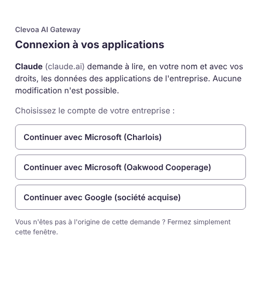
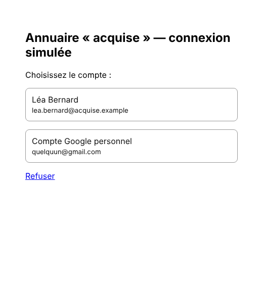
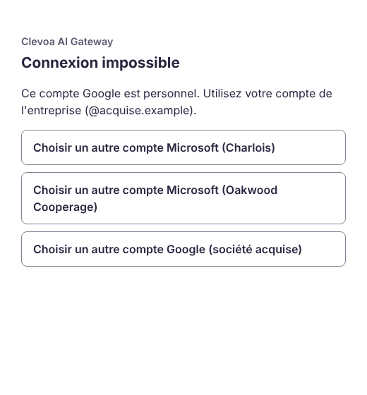

# Prototype « connexion en un clic » : guide pas à pas

Branche `proto/oauth-tunnel`, jetable et jamais fusionnée telle quelle. Étude de référence : [connexion en un clic](connexion-un-clic.md).
But : prouver qu'un collaborateur connecte le hub à Claude en cliquant sur « Connect », puis sur le nom de son entreprise,
sans clé à copier, sans Node.js sur son poste et sans aucun port ouvert sur le pare-feu.

Ce prototype ne touche à aucune installation client. Sage X3 et MyReport y tournent en **simulateur** (données fictives) ;
seule l'identité des collaborateurs (nom, e-mail) passe par les vrais annuaires, à partir de l'étape 2.

Les libellés d'interface sont donnés en français avec l'anglais entre parenthèses quand la langue dépend du compte.

## 1. Ce que fait le prototype

```
 Claude (claude.ai, IP 160.79.104.0/21)          Navigateur du collaborateur
        │ HTTPS                                          │ HTTPS
        ▼                                                ▼
 ┌──────────── Cloudflare (mcp-proto.socle.si) ─────────────┐   pare-feu Cloudflare (règle WAF) :
 └──────────────────────────┬───────────────────────────────┘   /mcp /token /register /revoke = Claude seulement
                            │ tunnel SORTANT (cloudflared → Cloudflare, port 7844)
 ┌─────────── machine Docker (aucun port entrant) ──────────┐
 │ cloudflared ──► mcp-hub:8090  autorisation OAuth + /mcp  │   réseau « tunnel » : cloudflared et le hub seulement
 │                 mcp-hub:8080  portail (127.0.0.1)        │
 │ mcp-stub :4000  annuaires simulés (127.0.0.1, étape 1)   │
 └───────────────────────────────────────────────────────────┘
        │ OIDC (étape 2)
        ▼
 Entra Charlois · Entra Oakwood Cooperage · Google Workspace de la société acquise
```

Le parcours du collaborateur :

1. Dans Claude : connecteur « Clevoa » → **Connect**.
2. Une fenêtre du hub s'ouvre : « Claude demande à lire… Choisissez le compte de votre entreprise ». Il clique sur
   **Continuer avec Microsoft (Charlois)** (ou Oakwood, ou Google).
3. Microsoft ou Google : déjà connecté, rien à faire ; sinon il saisit son compte comme chaque matin.
4. La fenêtre se ferme, Claude affiche « Connecté ». Fin.

| Page du hub (choix de l'annuaire et consentement) | Annuaire simulé (étape 1) | Compte refusé |
|---|---|---|
|  |  |  |

Thème sombre : [capture](prototype-un-clic/1-choix-annuaire-sombre.png). Après un refus, la page propose « Choisir un autre
compte » sans repartir de Claude.

Ce qui est construit dans le hub (désactivé par défaut, `OAUTH=on` pour l'activer), en termes simples :

* **le hub devient son propre serveur de connexion** (OAuth 2.1) : Claude s'y inscrit tout seul, puis obtient des jetons
  **du hub**, jamais ceux de Microsoft ou Google. Un jeton d'accès vaut 15 minutes ; il se renouvelle sans rien demander au
  collaborateur pendant 30 jours d'usage ;
* **le collaborateur prouve son identité auprès de son annuaire** (Entra ou Google) : le hub vérifie l'annuaire, le domaine
  de l'adresse, et refuse les comptes invités et les comptes Google personnels ;
* **un compte désactivé dans l'annuaire perd l'accès** en 75 minutes au plus : le hub réinterroge l'annuaire toutes les
  60 minutes, juste après un renouvellement (le collaborateur n'attend jamais l'annuaire) ;
* **un port à part (8090)**, le seul publié par le tunnel, ne sert que la connexion et `/mcp`. Le portail, les clés
  statiques, la supervision et le diagnostic n'existent pas de ce côté ;
* **seul Claude peut recevoir un code de connexion** (`claude.ai`, `claude.com`) ; tout autre site est refusé à
  l'inscription et à chaque usage.

Détails techniques : métadonnées RFC 9728 et RFC 8414, inscription dynamique (DCR), PKCE S256, `resource` (RFC 8707),
`iss` (RFC 9207), révocation (RFC 7009) ; connexion aux annuaires par openid-client (bibliothèque certifiée OpenID :
découverte, code + PKCE + nonce, signature de l'id_token vérifiée avec les clés publiées par l'annuaire, refresh) ; refresh token tourné à chaque usage (l'ancien reste
accepté 30 secondes, au-delà son retour ferme la session) ; demandes de connexion en cours portées par un cookie chiffré,
rien en mémoire avant le retour de l'annuaire.

## 2. Prérequis

| # | Prérequis | Qui | Étape |
|---|---|---|---|
| 1 | **Nom de domaine** sur Cloudflare : `socle.si` (voir § 3) ou un domaine de test dédié ; accès au registraire | toi | 1 |
| 2 | **Compte Cloudflare** gratuit, avec Zero Trust activé (nom d'équipe, offre Free). Cloudflare demande un **moyen de paiement** à l'inscription Zero Trust, même en offre gratuite (0 € facturé) | toi | 1 |
| 3 | **Machine Docker** allumée pendant les essais : Docker Engine ou Desktop avec **Compose 2.24 ou plus** (`docker compose version`), sortie Internet en 443 et 7844 (TCP et UDP) vers Cloudflare. Un portable suffit | toi | 1 |
| 4 | **Navigateur sur cette même machine** à l'étape 1 (annuaires simulés en `localhost:4000`), ou un tunnel SSH (§ 4.4) | toi | 1 |
| 5 | **Accès en lecture au dépôt GitHub** `sirkazey/Clevoa-IA-gateway` depuis la machine Docker | toi | 1 |
| 6 | **Compte Claude** : un compte individuel (Free : un seul connecteur personnalisé ; Pro ou Max) pour l'essai, puis le rôle **Owner** de l'organisation Team de Charlois pour l'essai à plusieurs | toi | 1 et 3 |
| 7 | `git`, `openssl` (génération des clés) | toi | 1 |
| 8 | **Entra Charlois** : le rôle **Administrateur d'applications cloud** suffit (inscription, consentement, affectation). Affectation par **groupe** : licence **Entra ID P1 ou P2** (sinon affecter des utilisateurs un par un). Deux comptes de test **non administrateurs** (l'affectation requise ne s'applique pas à un Administrateur général), plus si possible un compte invité et un compte d'un domaine fédéré pour les critères 15 et 16 | DSI Charlois | 2 |
| 9 | **Entra Oakwood Cooperage** : un administrateur de cet annuaire, et le domaine exact des adresses (`oakwoodcooperage.com` est une hypothèse) | DSI Oakwood | 3 |
| 10 | **Google Workspace de la société acquise** : un compte de l'organisation autorisé à créer un projet Google Cloud **dans l'organisation**, et le domaine principal Workspace | admin de la société acquise | 3 |
| 11 | **Avis DPO** avant l'étape 2 : Cloudflare termine le TLS et voit les échanges en clair (ici, des identités ; plus tard, des données métier) | DSI / DPO | 2 |

Coût : 0 € (Cloudflare Free, Tunnel gratuit, Claude Free ou existant). Le seul coût possible est un domaine de test
(environ 10 € par an) si tu choisis de ne pas toucher à socle.si.

## 3. socle.si ou un domaine de test ?

Pour publier `mcp-proto.socle.si` par un tunnel, **toute la zone `socle.si` doit être gérée par Cloudflare** : en offre
gratuite, Cloudflare exige de remplacer les serveurs DNS de la zone chez le registraire. La délégation partielle (CNAME)
est réservée aux offres Business et Enterprise.

Conséquences si tu passes socle.si chez Cloudflare :

* **avant tout**, exporter la zone actuelle chez l'hébergeur DNS (fichier de zone ou capture de tous les enregistrements)
  et noter les serveurs DNS actuels : c'est le retour arrière ;
* **tous** les enregistrements actuels doivent être recopiés avant la bascule : site web, `MX` et `TXT` de la messagerie
  (SPF, DKIM, DMARC), vérifications de domaine (Microsoft 365, Google). Cloudflare les importe automatiquement, mais
  l'import est incomplet en général (DKIM et sous-domaines peu courants) : compare avec l'export ;
* si **DNSSEC** est actif chez le registraire de socle.si, il faut retirer l'enregistrement DS **avant** de changer de
  serveurs DNS, sinon le domaine devient injoignable ; on le réactive ensuite depuis Cloudflare ;
* la propagation prend de quelques minutes à 24 heures ;
* les enregistrements existants restent en « DNS only » (nuage gris) s'ils n'ont pas à transiter par Cloudflare : garde
  la messagerie et le site tels quels.

**Retour arrière** si la messagerie ou le site cassent : chez le registraire, remettre les serveurs DNS notés, puis
réactiver DNSSEC (nouvel enregistrement DS de l'hébergeur d'origine) une fois la propagation faite.

**Ma recommandation** : si socle.si porte une messagerie ou un site en service, achète un domaine de test dédié
(`socle-proto.fr` ou équivalent) pour le prototype et ne bascule socle.si qu'au moment d'un vrai service. Le risque n'est
pas la sécurité, c'est de casser la messagerie de socle.si pendant un essai. Si socle.si n'héberge rien d'important,
utilise-le directement. Dans la suite, remplace `socle.si` par le domaine choisi.

## 4. Étape 1 — Cloudflare et Docker avec les annuaires simulés (environ 1 h 30)

Ordre voulu : la règle du pare-feu Cloudflare (§ 4.3) est en place **avant** que le tunnel ne s'ouvre (§ 4.4), pour que
l'inscription et `/mcp` ne soient jamais ouverts à tout Internet.

### 4.1 Ajouter le domaine à Cloudflare

1. [dash.cloudflare.com](https://dash.cloudflare.com) → **Ajouter un domaine (Add a domain)** → `socle.si` → offre **Free**.
2. Vérifier la liste des enregistrements importés (comparer avec l'export, § 3).
3. Chez le registraire de socle.si : désactiver DNSSEC si actif, puis remplacer les serveurs DNS par les deux fournis par
   Cloudflare.
4. Attendre l'état **Active** de la zone (e-mail de Cloudflare).

### 4.2 Créer le tunnel et sa route

1. Tableau de bord Cloudflare → **Zero Trust** (première fois : nom d'équipe, offre Free, moyen de paiement).
2. **Networks → Tunnels** (nouvelle interface : **Networking → Tunnels**) → **Create a tunnel** → type **Cloudflared** →
   nom `clevoa-proto` → **Save tunnel**.
3. Écran d'installation : choisir **Docker**. La commande affichée contient `--token eyJ…` : copier **uniquement le
   jeton** (la longue chaîne après `--token`). C'est un secret : il permet de faire tourner le tunnel n'importe où. Ne pas
   lancer la commande proposée : le tunnel tournera dans la pile Docker du prototype.
4. **Next** / **Continue**, puis ajouter la route : onglet **Public Hostname** (nouvelle interface : **Routes → Add route →
   Published application**) :
   * Subdomain : `mcp-proto` ; Domain : `socle.si` ; Path : vide ;
   * Service : **HTTP**, URL : `mcp-hub:8090` (et surtout pas `8080`, qui publierait le portail).
5. Enregistrer. Cloudflare crée lui-même l'enregistrement DNS `mcp-proto` (CNAME vers le tunnel). Le certificat
   universel de Cloudflare couvre `mcp-proto.socle.si` (un seul niveau de sous-domaine ; `a.b.socle.si` ne le serait pas).

### 4.3 Règles Cloudflare (avant de lancer la pile)

Tableau de bord → zone `socle.si` :

1. **Règle d'accès** : **Security → Security rules → Create rule → Custom rules** (ancienne interface : **Security → WAF →
   Custom rules → Create rule** ; offre gratuite : 5 règles).
   * Nom : `Clevoa : MCP réservé à Claude`.
   * Expression (bouton **Edit expression**) :
     ```
     (lower(http.host) eq "mcp-proto.socle.si" and not ip.src in {160.79.104.0/21} and (starts_with(lower(http.request.uri.path), "/mcp") or starts_with(lower(http.request.uri.path), "/token") or starts_with(lower(http.request.uri.path), "/register") or starts_with(lower(http.request.uri.path), "/revoke")))
     ```
   * Action : **Block**.
   * `lower` et `starts_with` (disponibles en offre gratuite, contrairement à l'opérateur `matches`) couvrent les variantes
     de casse et de barre finale (`/REGISTER`, `/mcp/`). Le hub, de son côté, ne répond qu'aux chemins exacts (toute
     variante reçoit 404) : les deux protections se recouvrent.
   * Les pages vues par le navigateur du collaborateur (`/authorize`, `/oauth/…`) et les métadonnées (`/.well-known/…`)
     restent ouvertes : elles ne donnent accès à aucune donnée.
2. **Limitation de débit** : **Security → Security rules → Create rule → Rate limiting rules** (ancienne interface :
   **Security → WAF → Rate limiting rules** ; une règle en offre gratuite). En offre gratuite, le filtre ne porte que sur le
   **chemin**, donc sur toute la zone : chemin commençant par `/oauth/` ou égal à `/authorize`, 20 requêtes par 10 secondes
   et par adresse IP, action **Block** pendant 10 secondes. Le hub borne déjà `/oauth/…` à 60 requêtes par minute et
   `/authorize` à 300 par 15 minutes, par adresse ; la règle Cloudflare arrête une rafale avant le tunnel.
3. **Bot Fight Mode** : **Security → Settings**, filtre « Bot traffic » (ancienne interface : **Security → Bots**) →
   **Off** pour la zone. Il peut bloquer les appels serveur de Claude, et ne se contourne pas par une règle WAF
   (documentation Cloudflare). Vérifier aussi que le blocage des robots d'IA (« Block AI bots » / AI Crawl Control) n'est
   pas actif sur ce nom d'hôte.
4. **SSL/TLS** : mode indifférent pour le tunnel ; laisser **Always Use HTTPS** actif.

`160.79.104.0/21` est la plage sortante (IPv4 seulement) publiée par Anthropic pour les appels MCP
([adresses IP d'Anthropic](https://platform.claude.com/docs/en/api/ip-addresses), consultée le 25 octobre 2026). Vérifie-la
avant d'agir : si elle change, Claude est bloqué sans autre message qu'un échec de connexion. Cette règle bloque aussi
Claude Code et les clients installés sur un poste (ils appellent depuis l'adresse du poste) : c'est voulu pour le prototype.

### 4.4 Lancer la pile Docker

```bash
git clone https://github.com/sirkazey/Clevoa-IA-gateway.git && cd Clevoa-IA-gateway
git checkout proto/oauth-tunnel
cp .env.proto.example .env.proto && chmod 600 .env.proto   # jamais commité (.gitignore), lisible par toi seul
openssl rand -hex 32                                         # → ENCRYPTION_KEY dans .env.proto
```

Dans `.env.proto` : `PROTO_HOST=mcp-proto.socle.si`, `CLOUDFLARE_TUNNEL_TOKEN=<jeton>`, `ENCRYPTION_KEY=<clé>`. À cette
étape, laisser vides les `OIDC_*_ISSUER`, `_CLIENT_ID` et `_CLIENT_SECRET` (annuaires simulés) ; les `_DOMAINS` et
`OIDC_PROVIDERS` sont déjà remplis.

```bash
docker compose -f docker-compose.proto.yml --env-file .env.proto up -d --build
docker compose -f docker-compose.proto.yml --env-file .env.proto ps        # mcp-hub « healthy », cloudflared démarré ensuite
docker compose -f docker-compose.proto.yml --env-file .env.proto logs cloudflared | grep -i registered   # 4 connexions
docker compose -f docker-compose.proto.yml --env-file .env.proto logs mcp-hub | grep "Serveur OAuth"
```

Une trentaine d'avertissements « variable is not set » s'affichent : ils viennent des variables facultatives du fichier
Docker commun (Salesforce, SharePoint…), sans effet ici.

Contrôles depuis la machine :

```bash
curl -s https://mcp-proto.socle.si/.well-known/oauth-protected-resource/mcp     # JSON : "resource": "https://mcp-proto.socle.si/mcp"
curl -s https://mcp-proto.socle.si/.well-known/oauth-authorization-server       # JSON : S256, registration_endpoint…
curl -si -X POST https://mcp-proto.socle.si/mcp | head -1                        # 403 : bloqué par la règle Cloudflare (tu n'es pas Claude)
curl -si -X POST http://localhost:8090/mcp | grep -iE '^HTTP|www-authenticate'  # en local : 401 + WWW-Authenticate: Bearer … resource_metadata=…
curl -si https://mcp-proto.socle.si/ | head -1                                   # 404 : pas de portail côté public
```

Le portail reste disponible en local sur `http://localhost:8080`. Le parcours de connexion complet ne fonctionne que par
le tunnel (les métadonnées annoncent l'adresse publique) ; en local, seuls les contrôles ci-dessus ont un sens.

**Docker sur une autre machine que le navigateur** (NAS, serveur) : à l'étape 1, le navigateur doit joindre les annuaires
simulés, publiés sur `127.0.0.1:4000` de la machine Docker seulement. Depuis ton poste : `ssh -L 4000:localhost:4000
<machine Docker>`, puis le navigateur de ton poste utilise `localhost:4000` comme si Docker était local. Ne pas publier ce
port sur le réseau : la mire simulée connecte « Marie Dupont » sans mot de passe.

**Secrets** :

* `.env.proto` contient le jeton du tunnel, la clé du store et, à l'étape 2, les secrets des annuaires : droits 600, jamais
  copié dans un ticket ni un message. `docker compose config` et `docker inspect` les affichent en clair : ne pas partager
  leur sortie ;
* jeton du tunnel divulgué : supprimer le tunnel dans Cloudflare et en recréer un (§ 4.2) ;
* `ENCRYPTION_KEY` dans un coffre (gestionnaire de mots de passe) : la perdre rend le store illisible, il faut alors
  `down -v` et faire reconnecter tout le monde ;
* noter dans un agenda la date d'expiration des secrets Entra et Google : un secret expiré coupe toutes les connexions de
  l'annuaire concerné (le journal du hub le signale, § 8).

### 4.5 Connecter Claude (annuaires simulés)

Compte Claude individuel :

1. claude.ai → **Personnaliser → Connecteurs (Customize → Connectors)** → **+ Ajouter → Ajouter un connecteur personnalisé
   (+ Add → Add custom connector)**.
2. Nom : `Clevoa (prototype)` ; URL : `https://mcp-proto.socle.si/mcp`.
   * Si la fenêtre propose des choix d'authentification : **Authentication : Sign in now** ; **OAuth client : Register
     automatically**. Ne pas choisir « Use Claude's published identity » : le hub ne gère pas encore ce mode (CIMD).
   * Si la fenêtre n'a qu'un écran : laisser les paramètres avancés (Client ID, secret) vides ; Claude s'inscrit lui-même.
   * Ces réglages ne se modifient plus après l'ajout : en cas d'erreur, supprimer le connecteur et le recréer.
3. **Ajouter**, puis **Connect** : la page du hub s'ouvre → **Continuer avec Microsoft (Charlois)** → sur l'annuaire simulé,
   choisir **Marie Dupont** → la fenêtre se ferme, le connecteur est **connecté**.
4. Nouvelle conversation → bouton **+** → **Connecteurs** : activer « Clevoa (prototype) ». Demander :
   *« Liste les représentations Sage X3 disponibles, puis montre les factures (YFAC). »* La réponse cite
   « Source : Sage X3 · simulateur ». Seuls Sage X3 et MyReport sont proposés : les autres applications exigent une
   connexion par le portail interne, hors du prototype.

Organisation Team (après l'essai individuel) : l'Owner ajoute le connecteur dans **Paramètres de l'organisation →
Connecteurs → Ajouter → Personnalisé → Web (Organization settings → Connectors → Add → Custom → Web)**, même URL ; chaque
membre le retrouve dans ses connecteurs, marqué « Custom », et clique **Connect**. L'application de bureau Claude reprend
les connecteurs du compte : rien à installer.

### 4.6 Test bloquant avant l'étape 2 : lien relayé

Faire le critère 13 (§ 7) **avant** de brancher un vrai annuaire. Il vérifie que claude.ai refuse un lien de connexion
ouvert par un autre compte Claude ; le hub ne peut pas s'en protéger seul (le lien est ouvert dans le navigateur de la
personne visée). S'il échoue, arrêter le prototype et me le signaler.

## 5. Étape 2 — Le vrai Entra de Charlois (environ 30 min, DSI Charlois)

1. [entra.microsoft.com](https://entra.microsoft.com) → **Applications → Inscriptions d'applications → Nouvelle inscription
   (App registrations → New registration)** :
   * Nom : `Clevoa AI Gateway (prototype)` ;
   * Types de comptes : **comptes de cet annuaire organisationnel uniquement** (un seul locataire) ;
   * URI de redirection : plateforme **Web**, `https://mcp-proto.socle.si/oauth/callback/charlois`.
2. **Certificats et secrets → Nouveau secret client** (durée courte, 3 à 6 mois pour un prototype) : copier la **valeur**
   immédiatement (elle ne se réaffiche pas) et noter la date d'expiration.
3. **Autorisations d'API** : Microsoft Graph, déléguées `openid`, `profile`, `email`, `offline_access` (et `User.Read`
   présente par défaut) → **Accorder le consentement administrateur pour Charlois** (sinon chaque collaborateur verrait un
   écran de consentement Microsoft).
4. **Configuration du jeton → Ajouter une revendication facultative → ID → `acct`** : signale au hub un compte invité
   (`acct=1`) même quand la revendication `idp` n'est pas émise.
5. **Obligatoire** : **Applications d'entreprise → Clevoa AI Gateway (prototype) → Propriétés → Affectation requise : Oui**,
   puis **Utilisateurs et groupes** : affecter le groupe pilote (licence P1/P2 ; groupes imbriqués non pris en compte) ou
   les utilisateurs un par un. Les autres comptes Charlois sont refusés par Microsoft avant d'atteindre le hub (AADSTS50105),
   **sauf les Administrateurs généraux**, à qui l'affectation ne s'applique pas : ne pas tester avec eux. Le hub refuse en
   plus les comptes invités (`idp`, `acct`) et les identifiants hors des domaines de `OIDC_CHARLOIS_DOMAINS`.
6. Page **Vue d'ensemble** : noter l'**ID de l'annuaire (locataire)** et l'**ID d'application (client)**.
7. Dans `.env.proto` :
   ```
   OIDC_CHARLOIS_ISSUER=https://login.microsoftonline.com/<ID de l'annuaire>/v2.0
   OIDC_CHARLOIS_CLIENT_ID=<ID d'application>
   OIDC_CHARLOIS_CLIENT_SECRET=<valeur du secret>
   OIDC_CHARLOIS_DOMAINS=charlois.com          # obligatoire : domaines des identifiants (UPN) acceptés
   OIDC_PROVIDERS=charlois                     # n'afficher que Microsoft (Charlois) : plus aucun annuaire simulé
   ```
8. `docker compose -f docker-compose.proto.yml --env-file .env.proto up -d` : le hub redémarre. Les connexions faites avec
   l'annuaire simulé « Charlois » sont refusées à leur prochaine revalidation (l'annuaire réel ne reconnaît pas leur
   jeton) : reconnexion demandée.
9. Dans Claude : **Disconnect** puis **Connect**. La page du hub n'affiche plus que « Continuer avec Microsoft (Charlois) » ;
   Microsoft reconnaît la session Windows ou Edge du collaborateur, ou demande le compte et la MFA habituelle.

Le hub identifie le collaborateur par son `oid` Entra et l'ID de l'annuaire, comme le SSO du portail : un collaborateur
déjà connu du portail retrouve la même identité. L'adresse e-mail ne sert qu'à l'affichage (dans Entra, elle est modifiable).

**Dès qu'un annuaire réel est branché, `OIDC_PROVIDERS` ne liste plus que des annuaires réels.** Le hub refuse au
démarrage un annuaire réel en http, un Entra hors de `login.microsoftonline.com` ou sans ID d'annuaire, un Google hors de
`accounts.google.com`, et la valeur « simule » comme identifiant d'une vraie application.

## 6. Étape 3 — Oakwood Cooperage et la société acquise

**Oakwood Cooperage (autre annuaire Entra).** Le plus simple : l'administrateur d'Oakwood crée sa propre inscription
d'application dans son annuaire, exactement comme au § 5 (y compris l'affectation requise), avec l'URI de redirection
`https://mcp-proto.socle.si/oauth/callback/oakwood`. Il te transmet l'ID de son annuaire, l'ID d'application et le secret
(par un canal sûr). Variables : `OIDC_OAKWOOD_ISSUER`, `_CLIENT_ID`, `_CLIENT_SECRET`, et `OIDC_OAKWOOD_DOMAINS` = domaine(s)
des comptes Oakwood. Alternative : une application multilocataire dans l'annuaire de Charlois, consentie par l'administrateur
d'Oakwood ; plus centralisée, mais elle demande une décision des deux DSI.

**Société acquise (Google Workspace).** Avec un compte de l'organisation Google de la société acquise :

1. [console.cloud.google.com](https://console.cloud.google.com) → créer un projet `clevoa-proto`, avec pour **Emplacement**
   l'organisation Workspace (sans cela, l'audience « Interne » n'est pas proposée).
2. **Google Auth Platform** (anciennement « Écran de consentement OAuth ») → type d'audience **Interne** : seuls les comptes
   de cette organisation peuvent se connecter, et Google n'exige aucune validation de l'application. Nom de l'application :
   `Clevoa AI Gateway (prototype)`. Accès aux données : `openid`, `email`, `profile`.
3. **Clients → Créer un client → Application Web** : URI de redirection autorisée
   `https://mcp-proto.socle.si/oauth/callback/acquise`. Copier l'ID client et le secret.
4. Variables : `OIDC_ACQUISE_ISSUER=https://accounts.google.com`, `_CLIENT_ID`, `_CLIENT_SECRET`, et
   `OIDC_ACQUISE_DOMAINS=<domaine Workspace>`. Le hub n'accepte que les comptes portant ce domaine Workspace (revendication
   `hd`) : un compte Gmail personnel est refusé même s'il passait l'écran de Google. À vérifier sur un vrai compte : pour un
   utilisateur d'un domaine secondaire du Workspace, la valeur de `hd` ; mettre au besoin tous les domaines dans la liste.

Google ne redonne un refresh token (nécessaire à la revalidation) qu'avec `prompt=consent` : les comptes Google voient
l'écran de consentement de Google à chaque **Connect**, c'est-à-dire la première fois, puis après 30 jours sans usage ou
une reconnexion forcée. Accepté pour le prototype ; à reconsidérer pour un service.

Puis `OIDC_PROVIDERS=charlois,oakwood,acquise` et `up -d` : la page du hub propose les trois comptes. Une même personne
qui se connecte par deux annuaires (par exemple Charlois puis Oakwood) a deux identités distinctes dans le hub.

## 7. Critères de réussite

Commandes abrégées : `dc` = `docker compose -f docker-compose.proto.yml --env-file .env.proto`.

| # | Vérification | Attendu |
|---|---|---|
| 1 | Métadonnées en https (§ 4.4) | JSON, `resource` = `https://mcp-proto.socle.si/mcp` |
| 2 | « Connect » dans Claude | 2 clics (Connect, nom de l'entreprise) + Microsoft ou Google s'il n'y a pas de session ouverte |
| 3 | Question Sage X3 dans Claude | réponse avec « Source : Sage X3 · simulateur » |
| 4 | Deux collaborateurs (Marie puis Paul, deux comptes Claude) | deux lignes `session ouverte` dans `dc logs mcp-hub` ; déconnecter l'un (Disconnect) ne déconnecte pas l'autre |
| 5 | Application de bureau Claude | le connecteur y est déjà, connecté |
| 6 | Compte Gmail personnel sur « Google (société acquise) » | page « Connexion impossible » avec « Choisir un autre compte » |
| 7 | Compte désactivé dans l'annuaire (étape 1 : `curl -X POST localhost:4000/oidc/_admin/disable -H 'Content-Type: application/json' -d '{"email":"paul.martin@charlois.com"}'`) | accès coupé en 75 minutes au plus ; quelques minutes avec `OAUTH_REVALIDATE_MIN=1` (ajouté à `.env.proto`, puis `dc up -d`) ; journal : `session fermée (annuaire charlois) : refusée par l'annuaire` |
| 8 | `dc restart mcp-hub` | Claude continue sans reconnexion (refresh) |
| 9 | `curl -X POST https://mcp-proto.socle.si/mcp` depuis ton poste | 403 Cloudflare (règle WAF) |
| 10 | `https://mcp-proto.socle.si/` | 404 : pas de portail |
| 11 | Ports de la machine Docker : `ss -ltnp \| grep -E ':(4000\|8080\|8090)'` (Linux) | uniquement `127.0.0.1` ; aucune règle entrante ni redirection de port sur le pare-feu |
| 12 | `dc logs mcp-hub \| grep -iE '@\|cgo_\|eyJ'` | aucune ligne (ni e-mail, ni jeton) |
| 13 | **Bloquant avant l'étape 2.** Lien relayé : depuis le compte Claude A, cliquer « Connect », copier l'URL de la page du hub (avant de choisir l'annuaire), l'ouvrir dans un navigateur connecté au compte Claude **B** et aller au bout | claude.ai refuse le retour (la demande appartient à la session de A) ; **si le connecteur de A devient connecté avec l'identité de B, arrêter le prototype** et me le signaler |
| 14 | `curl -X POST https://mcp-proto.socle.si/REGISTER` (variante de casse) | 403 Cloudflare ; en local sur `localhost:8090`, 404 du hub |
| 15 | Étape 2 : un compte **invité** B2B affecté à l'application | page « Connexion impossible » (compte invité) |
| 16 | Étape 2 : un compte d'un **domaine fédéré** de Charlois (ADFS, Okta), s'il en existe | connexion acceptée ; s'il est refusé comme invité, me le signaler (revendication `idp` à ajuster) |

## 8. En cas de problème

Le journal du hub (`dc logs mcp-hub`) n'écrit jamais d'identité ni de jeton ; ses messages utiles :

| Message du journal | Signification |
|---|---|
| `session ouverte (annuaire X)` | un collaborateur s'est connecté |
| `session fermée (annuaire X) : <raison>` | raisons possibles : `refusée par l'annuaire (compte désactivé ou session révoquée)`, `refresh token rejoué`, `expirée (inutilisée trop longtemps)`, `collaborateur retiré du hub`, `révoquée par l'assistant`, `code d'autorisation rejoué`, `annuaire injoignable ou application refusée depuis plus de 24 h` |
| `ALERTE : l'annuaire X refuse l'application du hub (invalid_client)` | secret client expiré ou erroné : personne n'est coupé tout de suite, mais tout le monde le sera au bout de 24 h ; renouveler le secret |
| `annuaire X injoignable (…) : revalidation reportée` | panne de l'annuaire, tolérée 24 h |
| `annuaire X : compte refusé par la politique du hub` | domaine, compte invité ou compte Google personnel |
| `annuaire X : échec de la connexion (401 invalid_client)` | secret ou identifiant de l'application erronés |
| `annuaire X : erreur <code>` | erreur renvoyée par Microsoft ou Google (`access_denied` = le collaborateur a refusé) |

| Symptôme | Cause probable |
|---|---|
| Claude : « Couldn't connect » dès l'ajout | règle WAF trop stricte ou Bot Fight Mode : **Security → Events** de Cloudflare, chercher `/mcp` et `/register` |
| La page du hub s'affiche, l'annuaire simulé ne s'ouvre pas | navigateur sur une autre machine que Docker (§ 4.4, tunnel SSH) |
| Microsoft : AADSTS50011 | URI de redirection différente de `https://mcp-proto.socle.si/oauth/callback/charlois` |
| Microsoft : AADSTS65001 | consentement administrateur non accordé (§ 5, étape 3) |
| Microsoft : AADSTS50105 | affectation requise et collaborateur hors du groupe pilote (voulu) |
| Le hub ne démarre pas | message `[oauth-server]` explicite dans `dc logs mcp-hub` (variable manquante, ISSUER Entra sans ID d'annuaire, « simule » avec un vrai annuaire…) |
| cloudflared ne démarre pas | il attend que le hub soit « healthy » (`dc ps`) ; sinon sortie 7844 bloquée par le pare-feu |
| Le connecteur demande de se reconnecter | voir la raison `session fermée` dans le journal |

## 9. Nettoyage

1. `docker compose -f docker-compose.proto.yml --env-file .env.proto down -v --rmi local` (`-v` efface le store du
   prototype : sessions, inscriptions, identités, refresh tokens des annuaires ; `--rmi local` les images construites).
2. Cloudflare : supprimer le tunnel `clevoa-proto` (Zero Trust → Tunnels), l'enregistrement DNS `mcp-proto`, la règle
   d'accès et la règle de limitation de débit ; réactiver Bot Fight Mode et le blocage des robots d'IA s'ils l'étaient ;
   retirer le moyen de paiement Zero Trust si tu n'utilises plus Zero Trust.
3. Domaine : si socle.si n'a été passé chez Cloudflare que pour le prototype, appliquer le retour arrière du § 3.
4. Claude : supprimer le connecteur (compte individuel et organisation).
5. Entra (Charlois et Oakwood) : supprimer l'inscription d'application (ou au moins son secret) et le groupe pilote s'il a
   été créé pour l'occasion.
6. Google : supprimer le client OAuth ou le projet `clevoa-proto`.
7. Supprimer `.env.proto` de la machine.

La pile du prototype n'a pas de sauvegarde automatique. Les scripts `ops/backup.sh` et `ops/restore.sh` cherchent le volume
d'une installation (`mcp-data`) : pour le prototype, passer `VOLUME=clevoa-proto_proto-data`. Une sauvegarde contient, chiffrés,
les refresh tokens des annuaires : la détruire avec le reste.

## 10. Prouvé, à prouver, limites

**Prouvé ici** (128 tests du hub, 13 du bouchon, dont 18 pour le prototype, et un parcours dans un vrai navigateur
Chromium) : parcours complet avec le client OAuth du SDK MCP qui se comporte comme Claude (découverte, inscription, PKCE,
`resource`) jusqu'à l'appel d'un outil ; trois annuaires dont un Google ; refus des comptes hors politique, des invités et
des id_token falsifiés (émetteur, audience, annuaire, nonce, expiration) ; « Choisir un autre compte » après un refus ;
deux fenêtres « Connect » simultanées ; liaison d'une identité à une seule clé ; rotation, délai de grâce, rejeu et
révocation des jetons ; scope propre à l'assistant ignoré ; revalidation après la réponse, coupure d'un compte désactivé,
tolérance d'une panne et d'un secret refusé, avec alerte ; persistance après redémarrage ; clients revérifiés contre la
liste d'adresses de retour ; cloisonnement du port public et chemins exacts ; débit borné ; réglages illisibles refusés ;
verrous de démarrage. Le fichier Compose est validé par `docker compose config` et son contrôle de santé contre un hub réel.

**À prouver par toi** (impossible depuis mon environnement : ni Docker en fonctionnement, ni Cloudflare, ni Entra, ni
Google, ni Claude) : le tunnel réel, la règle WAF avec les adresses de Claude, l'inscription réelle de Claude auprès du
hub, le flux de bout en bout dans claude.ai et dans l'application de bureau, le critère 13, le comportement d'Entra
(consentement, affectation, MFA, désactivation, invités, domaines fédérés) et de Google (`hd`, consentement).

**Limites assumées du prototype** :

* Sage X3 et MyReport seulement, en simulateur. Les connexions par application (Salesforce, SharePoint, Dropbox) restent
  sur le portail interne et ne sont pas proposées aux collaborateurs connectés par Claude ; les enchaîner dans le même
  parcours est l'étape suivante.
* Une seule instance du hub ; jetons d'accès et codes en mémoire (un redémarrage force un renouvellement, sans reconnexion).
* Un refresh token remplacé reste accepté 30 secondes (réponse perdue) ; au-delà, son retour ferme la session.
* Inscription dynamique ouverte aux adresses de Claude (règle WAF), bornée par la liste d'adresses de retour (Claude
  seulement ; la boucle locale demande `OAUTH_LOOPBACK: "on"` dans `docker-compose.proto.yml`) et un plafond de 500 clients,
  au-delà duquel les inscriptions de plus de 24 h sans session sont oubliées ; pas de CIMD, que le SDK ne gère pas encore.
* Le store chiffré contient les empreintes des jetons du hub, les refresh tokens des annuaires (pour la revalidation) et les
  secrets des clients inscrits : `ENCRYPTION_KEY` protège donc aussi l'accès aux annuaires.
* Pas d'écran d'administration des sessions : la coupure passe par l'annuaire (désactivation, retrait de l'affectation) ou
  par l'effacement du store. Retirer un collaborateur du hub le coupe, mais il peut se reconnecter tant que l'annuaire
  l'accepte.
* Les sièges comptés par la télémétrie ne comptent que les collaborateurs ayant connecté une application : un collaborateur
  qui n'utilise que les simulateurs n'en est pas un. À trancher avant tout comptage de licences.
* Cloudflare voit les échanges en clair : à soumettre au DPO avant toute donnée réelle (alternative étudiée : relais frp,
  [étude § relais](connexion-un-clic.md)).
* Aucun test d'intrusion externe : obligatoire avant un service réel.

## 11. Relectures indépendantes

**Première revue de sécurité** (25 octobre 2026) : GO sous réserve. Constats corrigés : saturation de la mémoire par
`/oauth/login`, règle WAF contournable par la casse, invités Entra acceptés, plafond d'inscriptions jamais purgé, boucle
locale ouverte par défaut, révocation par un autre client, cookie sans préfixe `__Host-`, émetteurs réels non contrôlés en
pré-production, portée réduite non appliquée.

**Relecture complète par quatre relecteurs** (sécurité, fonctionnel, documentation, exploitation), tous **GO sous
réserve**, aucun bloquant. Corrections :

| Relecture | Constat | Correction |
|---|---|---|
| Sécurité | Blocage de toutes les connexions en remplissant la table des demandes (démontré : 5 000 demandes en 3 s) | demandes portées par un cookie chiffré par demande : plus aucune table à remplir |
| Sécurité | Lien relayé vers un autre compte Claude | dépend de claude.ai : critère 13 bloquant avant l'étape 2 (§ 4.6) |
| Sécurité | Clients inscrits non revérifiés après un resserrement des adresses de retour | revérification à chaque usage |
| Sécurité | Réglage illisible (« 1h ») désactivant la revalidation | réglages numériques vérifiés au démarrage |
| Sécurité, exploitation | Portail et annuaire simulé publiables sur le réseau par une variable oubliée ; cloudflared voyant le bouchon | ports en dur sur `127.0.0.1`, réseau « tunnel » réservé à cloudflared et au hub |
| Sécurité | Corps de `/mcp` lu avant le jeton ; paramètres d'annuaire pouvant écraser `state` ou PKCE | jeton vérifié d'abord ; paramètres du hub prioritaires |
| Fonctionnel | Réponse perdue ou réessai : session fermée ; renouvellement attendant l'annuaire jusqu'à 15 s | délai de grâce de 30 s ; revalidation après la réponse ; délais vers l'annuaire de 3 et 5 s |
| Fonctionnel | Scope propre à l'assistant refusé au renouvellement | ignoré, comme à l'autorisation |
| Fonctionnel | Aucune trace des sessions fermées ; secret expiré pris pour un compte désactivé | raison journalisée ; alerte `invalid_client` sans coupure immédiate |
| Fonctionnel | Outils Salesforce, SharePoint, Dropbox proposés mais inutilisables | seuls les systèmes utilisables sont proposés, et les instructions le disent |
| Fonctionnel | Une seule fenêtre « Connect » à la fois ; 10 min trop courtes avec la MFA ; retour sur le même compte refusé ; contraste des boutons ; messages | cookie par demande, 20 min prolongées au clic, « Choisir un autre compte », bordures à 3,8:1 et 3,9:1, messages réécrits, nom de l'instance et contact d'assistance |
| Fonctionnel | `client_secret_basic` accepté à l'inscription mais refusé ensuite | méthode effective `client_secret_post` annoncée au client |
| Exploitation | Contrôle de santé du seul port 8090 absent ; double écriture du store par renouvellement ; variables non transmises | contrôle des deux ports et démarrage de cloudflared après le hub ; une écriture ; `OAUTH_SESSION_DAYS`, `OAUTH_SUPPORT_CONTACT` transmises ; « simule » refusé avec un vrai annuaire |
| Exploitation | La CI ne tourne pas sur la branche | lancée à la main sur la branche (Semgrep, CodeQL, Gitleaks, Trivy) |
| Documentation | Menus Claude et Cloudflare dépassés, contrôles impossibles en local, prérequis manquants (paiement Zero Trust, licence P1, administrateurs), ordre des étapes, secrets, retour arrière DNS, nettoyage incomplet | guide repris en entier |
