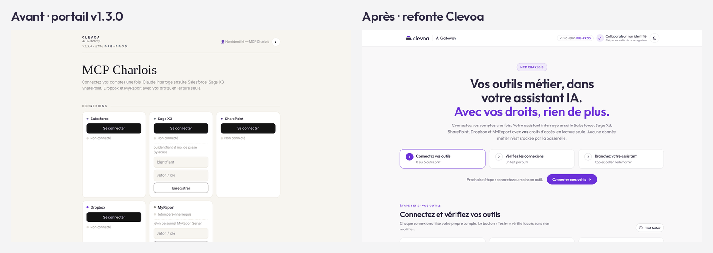
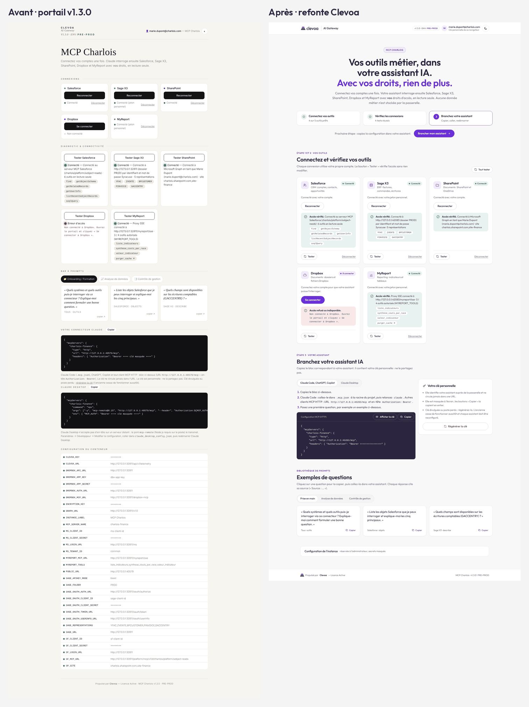
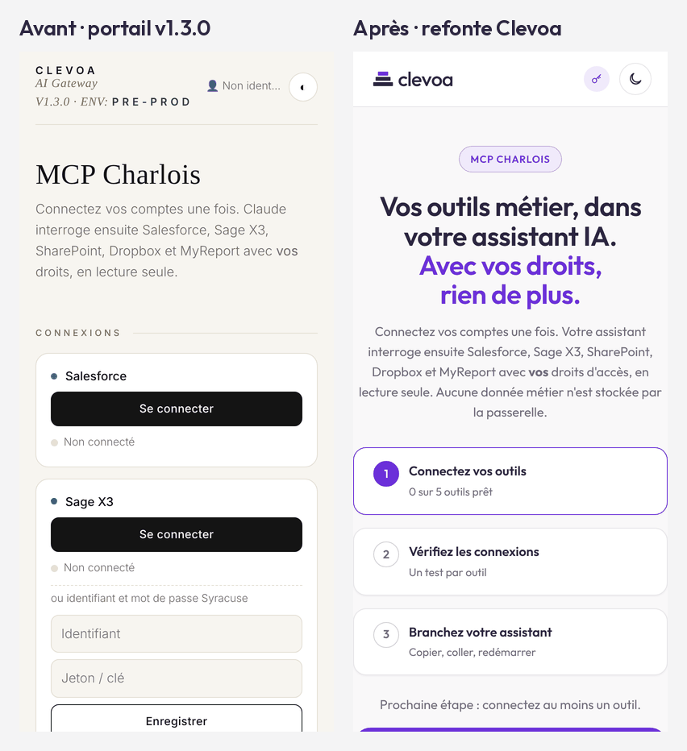
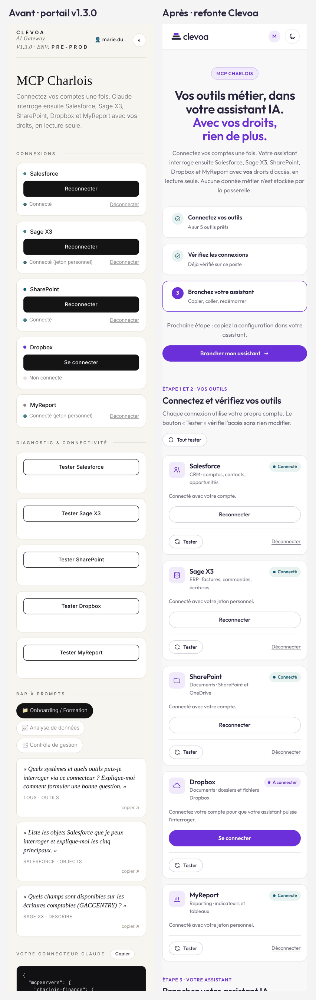
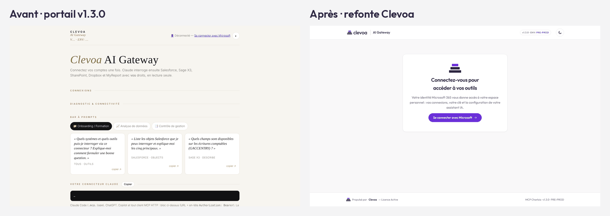
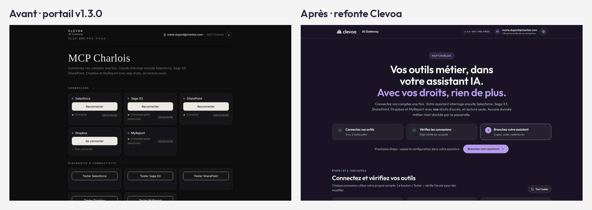

# Refonte du portail (v1.3.1) : validation

Compte rendu de la refonte graphique du portail : références utilisées, parcours vérifiés, accessibilité et captures
avant/après. Validation faite le 24 octobre 2026 sur le bouchon d'entreprise, jamais sur un système réel. La charte et
l'emplacement des ressources sont décrits dans [l'architecture](../developer/architecture.md#4-portail).

## Références

* **Charte Clevoa** : kit officiel du Drive Clevoa (logos SVG fond clair et fond sombre, symbole seul, favicons ;
  encre `#2B2540`, violet `#6B30D9`, violet clair `#B79CF0` ; police Outfit). Aucun logo redessiné.
* **Esprit SOCLE.SI** (site `socle.si`, dépôt `sirkazey/socle.si`) : fond clair aéré, badge pilule au-dessus d'un titre
  fort à deux tons, intertitres en petites capitales, boutons pilules (plein pour l'action principale, contour sinon),
  cartes à bord fin, icônes au trait. Palette et typographie de SOCLE.SI non reprises : celles de Clevoa priment.
* Écarté : dégradés, effets de verre, animations décoratives, ombres marquées.

## Ce qui change pour le collaborateur

| Avant (v1.3.0) | Après |
|---|---|
| Liste des connexions, puis une seconde liste de diagnostics | Une carte par outil : état, connexion, jeton, test et résultat au même endroit ; bouton « Tout tester » |
| Aucune indication de la prochaine action | Trois étapes (connecter, vérifier, brancher l'assistant) avec la prochaine action en évidence |
| Clé MCP affichée en clair dans les blocs de configuration | Clé masquée par défaut, « Afficher la clé » à la demande, copie toujours complète |
| Deux blocs de configuration l'un sous l'autre | Deux onglets avec des instructions numérotées propres à chaque assistant |
| Visiteur SSO déconnecté face à des sections vides | Écran de connexion dédié « Se connecter avec Microsoft » |
| Passerelle injoignable signalée par un libellé dans l'en-tête | Écran d'erreur avec « Réessayer » |
| Configuration de l'instance (40 lignes) en bas de chaque page | Bloc repliable réservé à l'administrateur |
| Charte bronze et vert, police à empattements, emojis | Logo et couleurs Clevoa, police Outfit, icônes au trait, thème sombre avec le logo pour fond sombre |

Aucune route, API, règle SSO, logique MCP ni connecteur n'a été modifié. Trois ajouts purement côté navigateur :
« Tout tester » (appels successifs au diagnostic existant, sous son plafond de 20 par minute), le masquage de la clé à
l'écran, et la mémorisation locale de l'avancement des étapes 2 et 3 (`localStorage`, sans donnée sensible).

## Contrôles

| Contrôle | Résultat |
|---|---|
| Tests automatisés du hub (`npm test`) | 78 tests, 77 exécutés, 0 échec ; le test de cohérence des URL vérifie aussi que chaque ressource statique citée existe et répond 200 |
| Parcours dans Chromium (Playwright, bouchon) | 13 parcours validés : premier écran, clavier, OAuth, jeton personnel, diagnostic, assistant, prompts, administration, thème, déconnexion et régénération de clé, mobile 360 px, SSO, passerelle injoignable |
| Accessibilité (axe-core 4.10.3, WCAG 2.1 A et AA) | 0 violation en thème clair, sombre, mobile et sur l'écran SSO ; contrastes de texte de 4,5:1 à 15:1 |
| Clavier | lien d'évitement, focus visible, onglets aux flèches, champs étiquetés, résultats annoncés (`aria-live`) |
| Mobile | aucun défilement horizontal à 360 px, cibles tactiles d'au moins 36 px |
| Poids ajouté | police 34 Ko (WOFF2, jeu latin), logos 11 Ko, favicons 3 Ko |

## Captures avant / après

Clés MCP masquées sur toutes les captures ; données issues du bouchon (collaboratrice fictive Marie Dupont).

| Vue | Capture |
|---|---|
| Accueil, ordinateur |  |
| Outils connectés et testés, ordinateur |  |
| Accueil, mobile |  |
| Outils connectés, mobile |  |
| Écran de connexion SSO |  |
| Thème sombre |  |

## Limites

Validation sur bouchon seulement : à revoir sur le portail de préproduction réel (SSO Entra, vrais libellés d'erreur
des éditeurs). Testé avec Chromium ; Firefox et Safari non vérifiés dans cet environnement. Les captures ont été prises avant
le passage du numéro de version : elles affichent « v1.3.0 », la refonte est livrée en 1.3.1.
