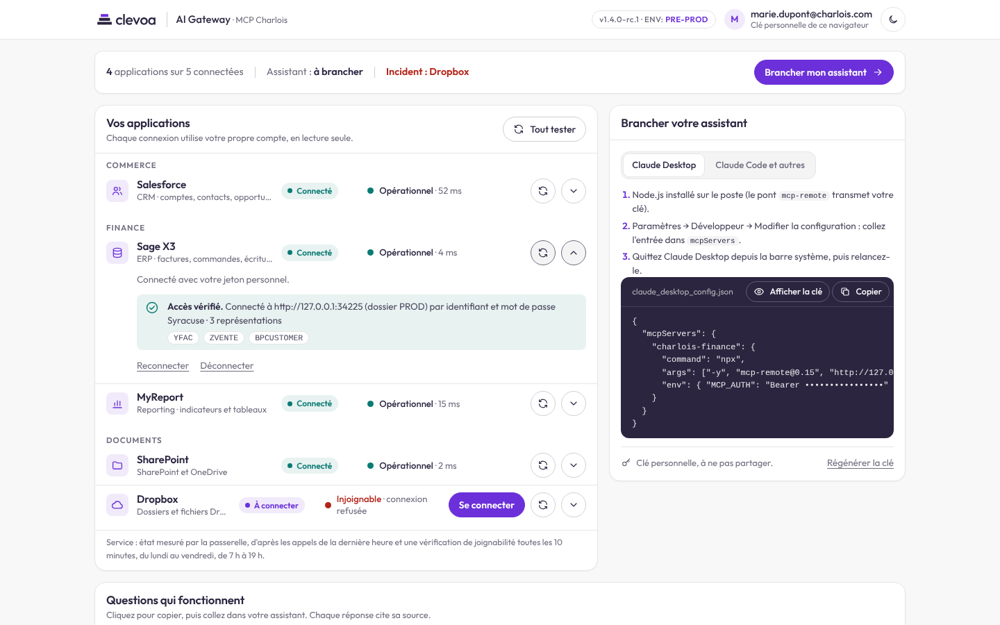
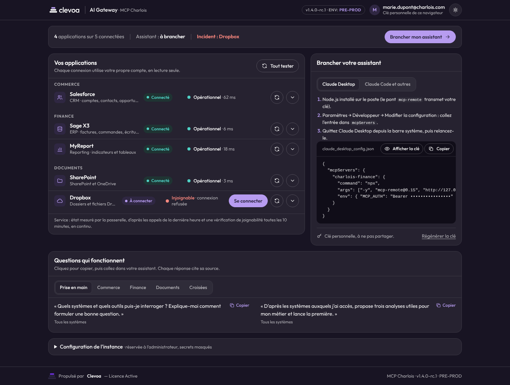
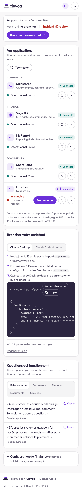

# Portail 1.4.0 : validation

Compte rendu de la refonte du portail en écran de travail, de l'état des systèmes et de la supervision. Validation faite
le 25 octobre 2026 sur le bouchon d'entreprise (collaboratrice fictive Marie Dupont), jamais sur un système réel.
Décision : [décisions, 2026-10-25](../history/decisions.md).

## Ce qui a changé et pourquoi

| Avant (1.3.1) | Après (1.4.0) | Raison |
|---|---|---|
| Grand titre d'accueil, accroche et trois étapes sur tout le premier écran | Bandeau d'une ligne : applications connectées, assistant branché ou non, incident en cours, prochaine action | un outil, pas une page d'accueil |
| Une grande carte par outil avec URL, liste d'outils et résultat de test toujours visibles | Une ligne par application, classée par domaine (Commerce, Finance, Documents…), détails repliés derrière une flèche | voir toutes les applications d'un coup d'œil |
| Aucun état du service | Colonne « Service » : Opérationnel avec le temps de réponse, Lent, Erreurs, Injoignable, Pas d'appel récent, Simulateur | savoir qu'une panne n'est pas celle de son compte |
| Configuration de l'assistant trois écrans plus bas | Panneau « Brancher votre assistant » en colonne de droite, visible sans défilement | l'action principale de la page |
| Exemples par thème (prise en main, analyse, contrôle de gestion) | « Questions qui fonctionnent » par domaine présent, plus « Croisées » ; une question qui demande une application non connectée l'indique | des exemples qui correspondent aux applications du collaborateur |

Le domaine d'une application vient du connecteur (Salesforce en Commerce, Sage X3 et MyReport en Finance, SharePoint et
Dropbox en Documents) et se change par `CONNECTOR_DOMAINS` (par exemple `sagex3=industrie` chez un industriel). Un
domaine sans application n'est jamais affiché.

## État des systèmes

Calculé par le hub (`hub/health.js`), sans aucun identifiant :

* appels réels des collaborateurs sur la dernière heure : plus de 20 % d'erreurs du système sur au moins 5 appels donne
  « Erreurs » (« Injoignable » si ce sont surtout des erreurs réseau), un temps de réponse p95 au-delà de `SLOW_MS`
  (10 s) donne « Lent » ; les erreurs d'usage (outil non connecté, hors liste blanche) ne comptent pas ;
* une requête `HEAD` vers chaque système réel toutes les 10 minutes, du lundi au vendredi de 7 h à 19 h : toute réponse
  HTTP prouve la joignabilité ; échec DNS, certificat, refus de connexion ou délai de 5 s donnent « Injoignable » avec la
  cause. Hors de ces heures, sans appel récent, la ligne indique « Pas d'appel récent · vérification en pause ».

Le portail n'affiche jamais un volume d'appels ni une identité. La même mesure est exposée à la supervision par
`/metrics` ([exploitation § 11](../admin/exploitation.md#11-supervision-du-hub)).

## Vérifications

| Vérification | Résultat |
|---|---|
| Tests du hub | 112 tests (111 exécutés et 1 réservé à la production ; en mode production 110 et 2), dont 6 pour l'état des systèmes et `/metrics` ; cohérence des URL de la page avec les routes du serveur |
| Accessibilité (axe-core, WCAG 2.1 A et AA) | 0 violation en thème clair (détail d'une ligne ouvert), sombre et mobile |
| Débordement horizontal | aucun à 1 440 px et 390 px |
| Erreurs de la console du navigateur | aucune |
| Données réelles des captures | bouchon : Salesforce et SharePoint connectés par la mire simulée, Sage X3 et MyReport par jeton, quelques appels MCP ; Dropbox pointé volontairement vers un port fermé pour montrer un incident |

Testé avec Chromium seulement. Clés MCP masquées sur toutes les captures.

## Captures

Premier écran, poste de travail (le détail de Sage X3 est ouvert après un test) :

Thème sombre :

Téléphone :

Avant, pour comparaison : [portail 1.3.1](portail-v1.3.1/2-outils-connectes-desktop.png).

## Reste à faire

* Revue par deux ou trois collaborateurs de Charlois sur la préproduction réelle (lisibilité de la colonne « Service »,
  libellés des domaines).
* Accord de l'équipe réseau de Charlois pour les requêtes `HEAD` régulières vers Sage X3 et MyReport.
* Capteur PRTG « HTTP Data Advanced » sur `/metrics/prtg` chez Charlois (exploitation § 11).
